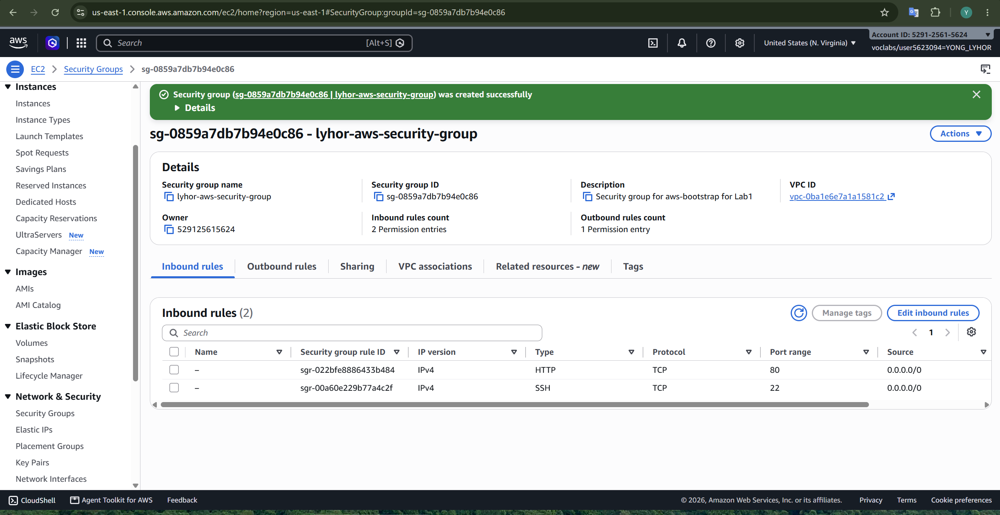
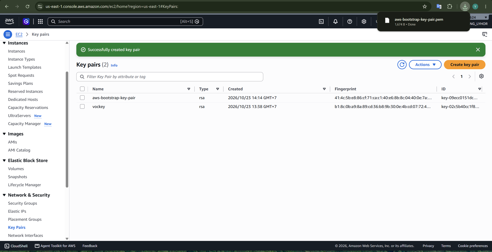
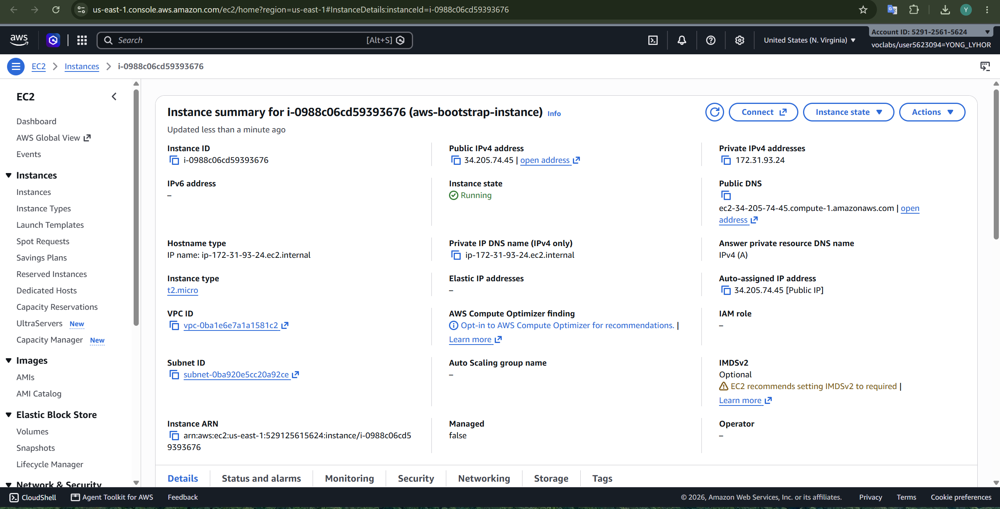
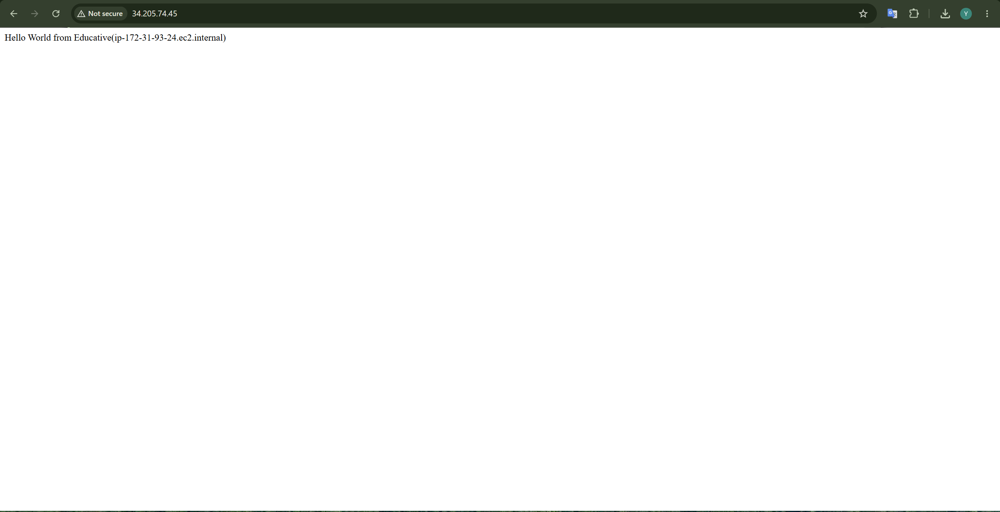
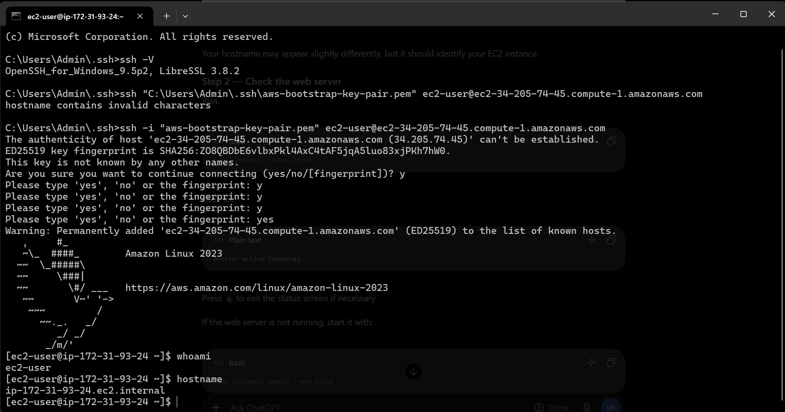
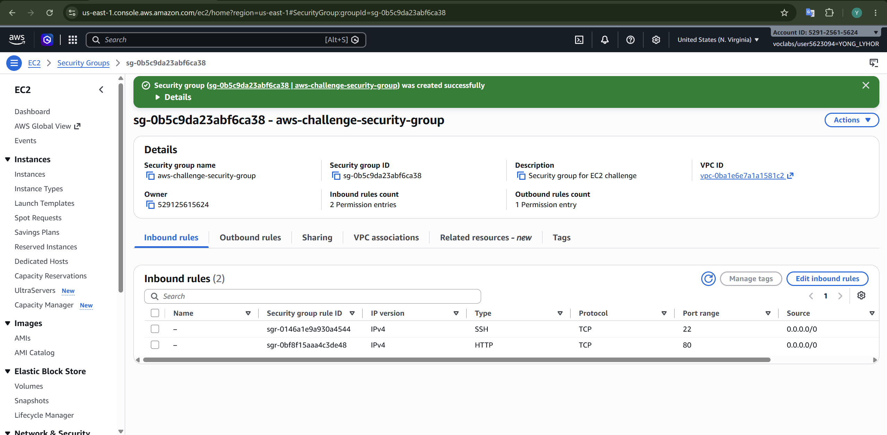
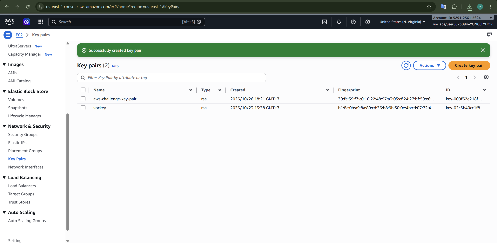
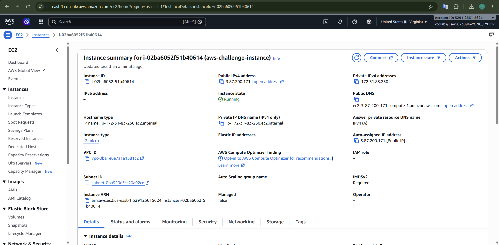
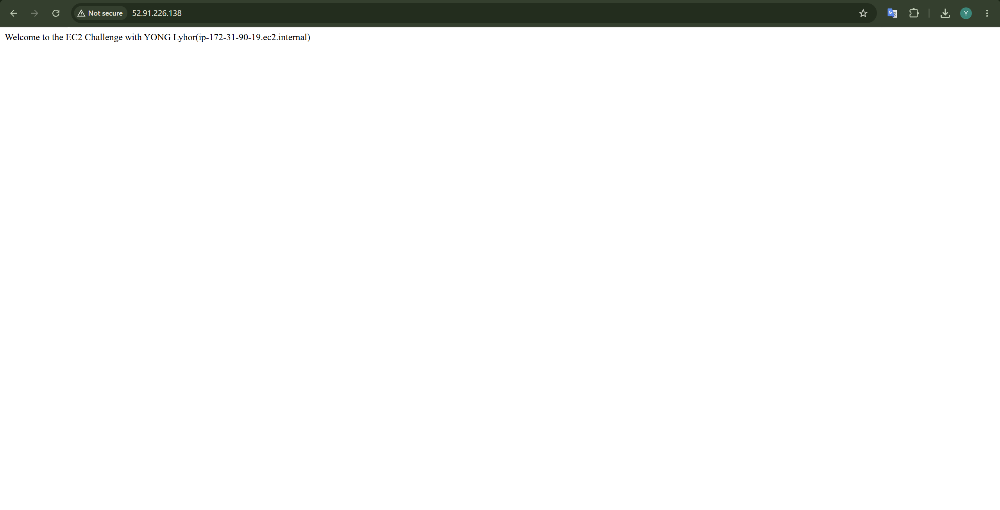
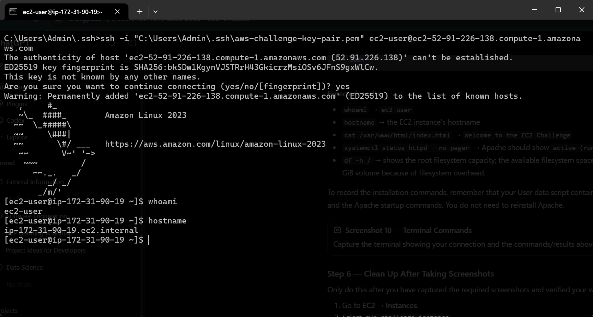

# Lab 1 – Launching and Connecting to Amazon EC2 Instances

**Name:** Yong Lyhor  
**ID:** e20221004  
**Group:** I5-AMS-DAS-B

This lab covers the basic EC2 workflow in the AWS Console (region **US East – N. Virginia, `us-east-1`**):

1. Create a security group
2. Create a key pair
3. Launch an Amazon Linux 2023 instance that runs a web server
4. Verify it in the browser (HTTP) and over SSH

The lab has two parts: the **guided bootstrap** exercise and the **EC2 challenge**, which repeats the workflow with a custom web page.

## Part 1 – Guided Bootstrap Exercise

### 1. Security group

Created `lyhor-aws-security-group` ("Security group for aws-bootstrap for Lab1") in the default VPC with these inbound rules:

| Type | Protocol | Port | Source    |
|------|----------|------|-----------|
| HTTP | TCP      | 80   | 0.0.0.0/0 |
| SSH  | TCP      | 22   | 0.0.0.0/0 |



### 2. Key pair

Created the RSA key pair `aws-bootstrap-key-pair`. The `.pem` private key was downloaded once and is used for SSH.



### 3. EC2 instance

Launched `aws-bootstrap-instance`:

| Setting          | Value                                    |
|------------------|------------------------------------------|
| Instance type    | t2.micro                                 |
| State            | Running                                  |
| Public IPv4      | 34.205.74.45                             |
| Private IPv4     | 172.31.93.24                             |
| Public DNS       | ec2-34-205-74-45.compute-1.amazonaws.com |
| Security group   | lyhor-aws-security-group                 |
| Key pair         | aws-bootstrap-key-pair                   |



### 4. Test the web server

Opening `http://34.205.74.45` returns the page served by the instance: `Hello World from Educative(ip-172-31-93-24.ec2.internal)`.



### 5. SSH connection

Connected from Windows with OpenSSH:

```powershell
ssh -i "aws-bootstrap-key-pair.pem" ec2-user@ec2-34-205-74-45.compute-1.amazonaws.com
```

Notes:

- The first attempt, which passed the key path without `-i`, failed with `hostname contains invalid characters`. The `-i` option is required to select the identity file.
- Accept the host fingerprint prompt by typing the full word `yes`.
- `whoami` returned `ec2-user` and `hostname` returned `ip-172-31-93-24.ec2.internal`.



## Part 2 – EC2 Challenge

### 1. Security group

Created `aws-challenge-security-group` ("Security group for EC2 challenge") with SSH (22) and HTTP (80) open to `0.0.0.0/0`.



### 2. Key pair

Created the RSA key pair `aws-challenge-key-pair`.



### 3. EC2 instance

Launched `aws-challenge-instance`:

| Setting          | Value                                  |
|------------------|----------------------------------------|
| Instance type    | t2.micro                               |
| State            | Running                                |
| Public IPv4      | 3.87.200.171 (as shown in the console) |
| Private IPv4     | 172.31.83.250 (as shown in the console)|
| IMDSv2           | Required                               |



### 4. Test the web server

The custom page shows `Welcome to the EC2 Challenge with YONG Lyhor(ip-172-31-90-19.ec2.internal)`.



### 5. SSH connection

```powershell
ssh -i "C:\Users\Admin\.ssh\aws-challenge-key-pair.pem" ec2-user@ec2-52-91-226-138.compute-1.amazonaws.com
```

`whoami` returned `ec2-user` and `hostname` returned `ip-172-31-90-19.ec2.internal`.



> The instance details screenshot (08) shows `3.87.200.171` / `172.31.83.250`, while the browser and SSH screenshots (09, 10) show `52.91.226.138` / `ip-172-31-90-19`. They appear to come from different launches of the challenge instance; re-capture them from the same instance if a consistent set is needed.

## Key Takeaways

- A **security group** acts as a virtual firewall. Port 80 is needed for web traffic and port 22 for SSH.
- A **key pair** authenticates SSH access. Keep the `.pem` file private and never commit it to Git.
- Amazon Linux 2023 uses the default user `ec2-user`.
- A **user data** script can install and start Apache (`httpd`) at launch, so the instance serves a web page without manual setup.
- Opening SSH to `0.0.0.0/0` is acceptable for a lab only. Restrict it to your own IP in real environments.
- Terminate instances after finishing to avoid charges.
